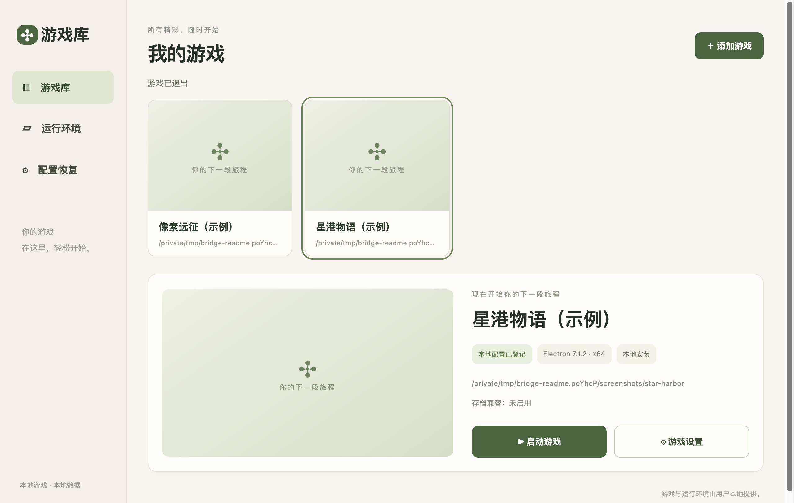
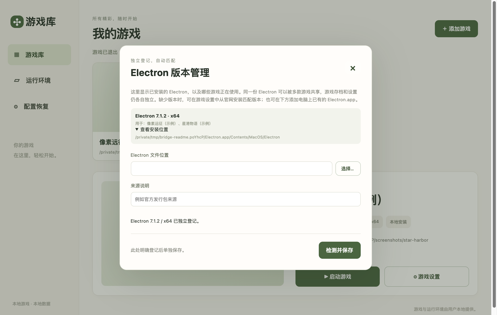
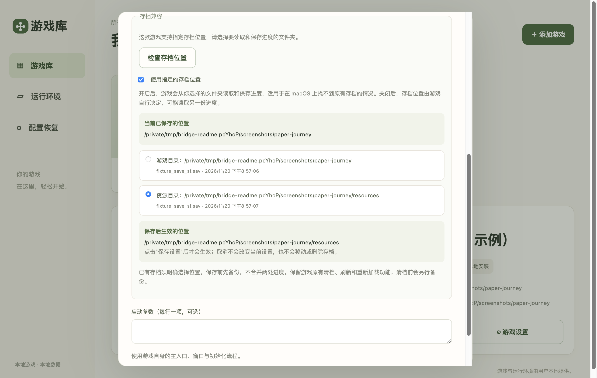

# Electron Game Bridge

[简体中文](README.md) · **English**

Manage and launch Electron games distributed for Windows on macOS. Add a game's complete distribution folder and the launcher detects the required Electron version, then uses a matching macOS build to run the game's original entry point. The game package stays intact.

## Supported games

Keep the EXE and resources from the Windows distribution together. The folder you import should contain `resources/app.asar` or `resources/app`. If you only have an EXE, obtain the accessible application resources first. Games that depend on Windows-only components or incompatible native modules may fail to launch.

## Quick start

1. Download the ZIP for your Mac. Choose `arm64` for Apple silicon or `x64` for Intel. Unzip it and open `Electron Game Bridge.app`. The app includes its own Electron runtime and requires macOS 13 or later. [Download for macOS](https://github.com/ddddyyyy/electron-game-bridge/releases/latest)
2. Click **添加游戏** (Add game), enter a name, and select the complete distribution folder. Leave the entry point set to `.` to detect the packaged resources automatically. Once the required version is identified, register a local Electron build or click **从官网安装匹配版本** (Install matching version).
3. Click **保存设置** (Save settings), select the game in the library, then click **启动游戏** (Launch game).

The release is ad hoc signed and has no Apple notarization. macOS may ask you to approve the app in **System Settings → Privacy & Security** the first time you open it. [Apple Support](https://support.apple.com/en-us/102445)

To run from source, download an official `Electron.app` and run `LAUNCHER_ELECTRON='/path/to/Electron.app' ./启动游戏库.command` from the project folder. [Official Electron releases](https://github.com/electron/electron/releases)

## Screenshots

The screenshots show the launcher’s Chinese interface with synthetic test games and saves. The library starts empty.

**Game library.** Switch between local games, see the matching Electron version, installation folder, and save compatibility status, or open settings and launch a game.

**Electron runtimes.** See registered Electron builds and the games using them, or detect and register an existing `Electron.app`. Official downloads show progress and can be canceled. The launcher verifies downloads with SHA-256 and probes the executable before registering it. Games can share a runtime when the version and architecture match.

**Save compatibility.** For recognized Tyrano 500/520 file-save implementations, inspect saves in the game folder and `resources`, then choose the location to use at the next launch. The launcher backs up the selected saves before enabling or changing the location. Progress in each folder stays separate.

## Local data and documentation

The packaged app stores settings, default game data, and logs under `~/Library/Application Support/Electron Game Bridge/`. Running from source keeps using `.launcher/` and `logs/` in the project folder. If the configuration is damaged, use **配置恢复** (Configuration recovery) to restore the last valid library configuration.

[Runtime management](specs/003-runtime-management/spec.md) · [Save compatibility limits](specs/002-engine-save-compat/validation.md) · [Save recovery steps](specs/002-engine-save-compat/quickstart.md#7-人工恢复与回退) (Chinese)
