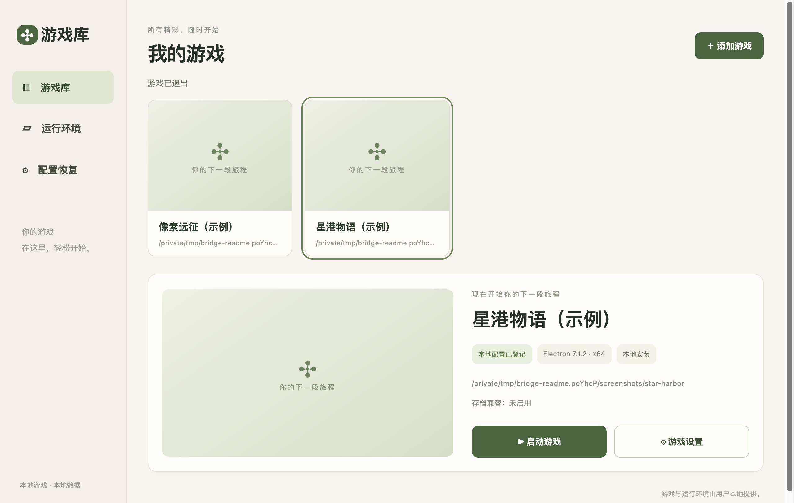
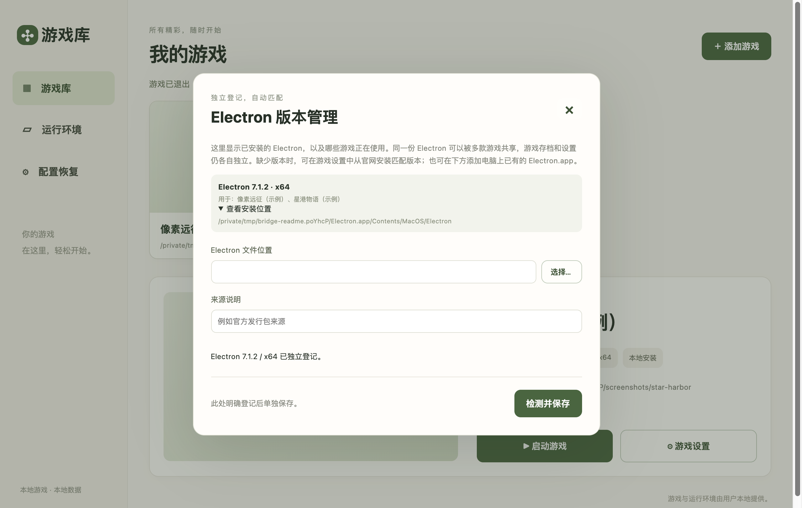
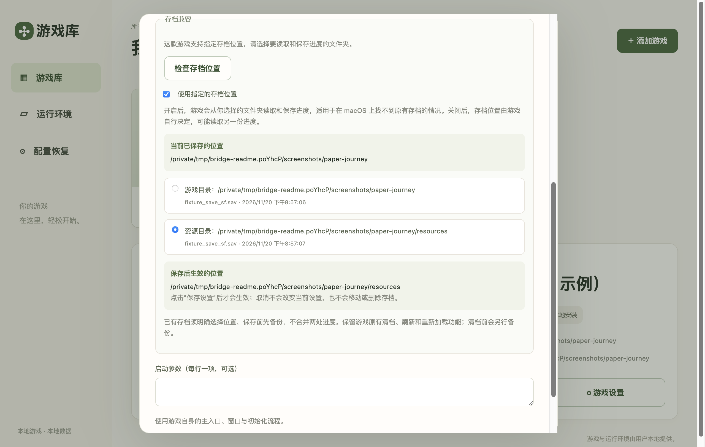

# Electron Game Bridge

**简体中文** · [English](README.en.md)

在 macOS 上管理和启动随 Windows 版发布的 Electron 游戏。添加游戏的完整发行目录后，启动器识别它需要的 Electron 版本，并用匹配的 macOS Electron 加载游戏原始入口。游戏包保持原样。

## 适用范围

请保留 Windows 发行目录里的 EXE 和资源。导入的目录应包含 `resources/app.asar` 或 `resources/app`。只有单个 EXE 时，需要先取得可读取的应用资源。依赖 Windows 专属组件或不兼容原生模块的游戏可能无法启动。

## 快速开始

1. 从发布页下载对应的 ZIP。Apple 芯片选 `arm64`，Intel 芯片选 `x64`。解压后打开 `Electron Game Bridge.app`。发布包内置启动器使用的 Electron，要求 macOS 13 或更新版本。[下载 macOS 版](https://github.com/ddddyyyy/electron-game-bridge/releases/latest)
2. 点击 **添加游戏**，输入名称并选择完整发行目录。应用入口保留默认的 `.` 即可自动查找打包资源。识别到所需版本后，可以登记已有 Electron，或点击 **从官网安装匹配版本**。
3. 点击 **保存设置**，回到游戏库选中该游戏，再点击 **启动游戏**。

发布包采用临时签名，尚未经过 Apple 公证。首次打开时，macOS 可能要求在 **系统设置 → 隐私与安全性** 中确认。[Apple 支持](https://support.apple.com/zh-cn/102445)

从源码启动时，请自备官方 `Electron.app`，在项目目录中运行 `LAUNCHER_ELECTRON='/path/to/Electron.app' ./启动游戏库.command`。[Electron 官方发行页](https://github.com/electron/electron/releases)

## 界面预览

截图来自实际运行的启动器，游戏和存档均为合成测试数据。首次启动时游戏库为空。

**游戏库。** 在多款本地游戏间切换，查看匹配的 Electron、安装目录和存档兼容状态，打开游戏设置或启动游戏。

**运行环境。** 查看已登记的 Electron 和使用它的游戏，或检测并登记现有的 `Electron.app`。官网下载支持查看进度和取消，下载后经 SHA-256 校验和运行探测再登记。同版本、同架构的运行环境可由多款游戏共用。

**存档兼容。** 对能够识别的 Tyrano 500/520 文件存档实现，可检查游戏目录和 `resources` 中的存档，明确选择下次启动使用的位置。启动器在启用或更换位置前备份选定的存档。两处进度各自保留。

## 本地数据与文档

发布版把设置、默认游戏数据和日志保存在 `~/Library/Application Support/Electron Game Bridge/`。源码运行时沿用项目目录下的 `.launcher/` 和 `logs/`。配置损坏时，可从 **配置恢复** 恢复最近一次有效的游戏库配置。

[运行环境管理](specs/003-runtime-management/spec.md) · [存档兼容限制](specs/002-engine-save-compat/validation.md) · [存档恢复步骤](specs/002-engine-save-compat/quickstart.md#7-人工恢复与回退)
